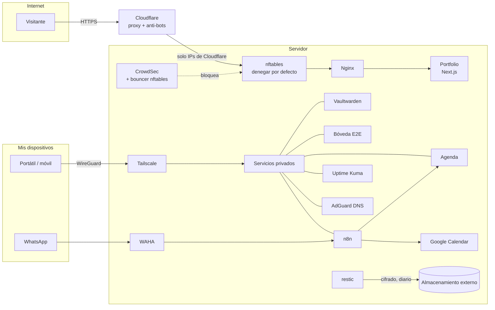

# Homelab

Configuración del servidor personal que aloja [bryanrg.dev](https://bryanrg.dev) y, en privado, las herramientas que uso a diario: gestor de contraseñas, una bóveda de documentos con cifrado de extremo a extremo, una agenda con asistente por WhatsApp y automatizaciones.

Sirve mi portfolio ([repo](https://github.com/BryanRuzafa/portfolio)) y es un único servidor ARM (Debian 13) administrado de principio a fin: red, firewall, detección de intrusiones, copias de seguridad, monitorización, actualizaciones y dos aplicaciones propias.

> Todo lo que identifica la infraestructura real está sustituido por valores de ejemplo: IPs de documentación (`203.0.113.0/24`, `198.51.100.0/24`, `2001:db8::/32`), un tailnet ficticio y variables `${...}` con su `.env.example`. Los secretos, las bases de datos y las copias nunca forman parte del repositorio.

## Arquitectura



## Decisiones y por qué

**Los servicios privados solo existen dentro de la VPN.** Panel, gestor de contraseñas, bóveda, n8n y SSH solo escuchan en `127.0.0.1` y se publican en la tailnet con `tailscale serve`. Desde Internet no hay puerto que atacar. Elegí Tailscale (WireGuard) frente a exponer un login web porque elimina la superficie de ataque en lugar de defenderla.

**El firewall deniega todo por defecto.** [`security/nftables.conf`](security/nftables.conf) solo abre 80/443 a los rangos de Cloudflare ([`scripts/update-cloudflare-ips`](scripts/update-cloudflare-ips) los actualiza cada mes), así que la IP real del servidor no responde a escaneos. Las peticiones por IP o con dominios desconocidos se cortan en Nginx sin revelar el certificado ([`nginx/00-default-deny.conf`](nginx/00-default-deny.conf)).

**CrowdSec en lugar de fail2ban.** fail2ban solo reacciona a lo que ve en este servidor. CrowdSec añade una lista comunitaria de IPs maliciosas (más de 15.000 bloqueadas de forma preventiva), escenarios mantenidos para HTTP y SSH, y un bouncer de nftables en los hooks `input` y `forward`, que también protege los puertos publicados por Docker. Configuración en [`security/crowdsec/`](security/crowdsec/).

**Docker sin saltarse el firewall.** Los contenedores publican sus puertos solo en `127.0.0.1`. El que necesita la red del host (AdGuard, por el DNS) usa `network_mode: host` precisamente para que sus puertos pasen por las reglas de nftables, en lugar de por las de Docker.

**Cifrado de conocimiento cero en la bóveda.** [`apps/boveda`](apps/boveda) cifra cada archivo y cada nombre en el navegador (AES-256-GCM, clave derivada con PBKDF2-SHA256 de 600.000 iteraciones). El servidor solo guarda datos ilegibles y un hash del token de acceso. Los archivos que llegan por WhatsApp se cifran con la clave **pública** de la bóveda (ECDH P-256 + HKDF + AES-GCM), y solo el navegador, con la clave privada, puede abrirlos. El código es público porque la seguridad está en las claves, no en esconder el código.

**Un asistente que entiende español sin depender de nadie.** [`apps/agenda`](apps/agenda) interpreta mensajes como `C martes 15 dentista 12`, `G 12,50 cena` o una nota de voz: un intérprete propio de fechas y horas en español (con tests en `apps/agenda/tests`), transcripción de voz local con Whisper y Claude solo como respaldo para frases libres. Los flujos de n8n están en [`n8n/`](n8n/).

**Copias que sobreviven al servidor.** [`scripts/backup-server`](scripts/backup-server) hace cada noche una copia incremental cifrada con restic fuera del servidor, con copias consistentes de las bases de datos SQLite en caliente, historial de seis meses y verificación de integridad semanal.

**Se cuida solo, y avisa si no puede.** Actualizaciones automáticas del sistema y de los contenedores (con copia previa), vigilancia de cada servicio y de los recursos con Uptime Kuma, y avisos por WhatsApp a través de [`scripts/notify-relay.py`](scripts/notify-relay.py).

**Administración endurecida.** SSH solo con clave pública y solo dentro de la VPN ([`security/ssh/`](security/ssh/)); la web pública saca A+ en SSL Labs (TLS 1.2+ con intercambio de claves post-cuántico, HSTS con preload).

## Estructura

```
stacks/     docker compose de cada servicio (+ .env.example con valores de ejemplo)
apps/       código de las aplicaciones propias: bóveda E2E y agenda/asistente
n8n/        flujos de automatización (sin credenciales)
security/   nftables, CrowdSec, SSH, Docker y actualizaciones automáticas
nginx/      sitio público y servidor por defecto que corta las peticiones por IP
scripts/    copias, actualizaciones, salud del servidor, avisos y cifras públicas de CrowdSec
systemd/    servicios y temporizadores que lo automatizan todo
```

## Puesta en marcha (resumen)

1. Debian 13 con Docker, Tailscale, CrowdSec (+ `crowdsec-firewall-bouncer-nftables`), Nginx, restic y rclone.
2. Copia `security/` y `nginx/` a su sitio, sustituyendo las IPs de ejemplo por las reales.
3. En cada `stacks/<servicio>`, copia `.env.example` a `.env`, rellénalo y `docker compose up -d`.
4. Publica los servicios privados en la tailnet con `tailscale serve`.
5. Activa los temporizadores de `systemd/`.
